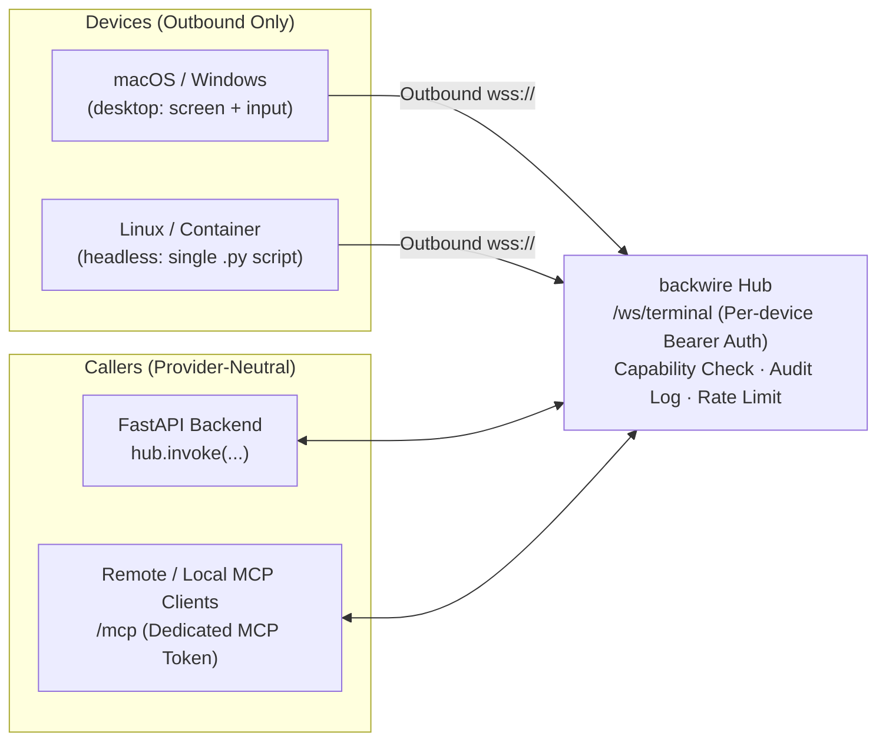

<div align="center">

# backwire

**Reverse WebSocket bridge for remote terminal and desktop operations.**

Embed directly in a FastAPI backend, or run as an authenticated Streamable HTTP / stdio MCP server.

[](https://github.com/chuli1122/backwire/actions/workflows/ci.yml)
[](LICENSE)
[](pyproject.toml)
[](#option-b-standalone-server--remote--local-mcp)
[](#connect-a-device-client)

**English** · [简体中文](README.zh-CN.md)

</div>

---

> [!CAUTION]
> Enabling `--allow-shell`, `--allow-write`, or `--allow-input` grants the connected model or caller **the corresponding privileges of the current OS account**.
> - Clients start in read-only mode (`read`, plus `screen` on `--kind desktop`). **Do not enable `--allow-shell` for an untrusted model or user.**
> - Use a dedicated low-privilege OS account and a long, unique token per device.
> - Terminate TLS (`wss://`) at a trusted reverse proxy on public networks; do not expose bare `ws://`.
> - `/mcp` requires a dedicated `BACKWIRE_MCP_TOKEN` separate from device tokens and rejects requests when unset.

## Overview

`backwire` connects machines behind a LAN, NAT, or container (without public IPs, inbound ports, or VPN/TUN interfaces) to a hub over an outbound WebSocket. An embedded FastAPI application or an MCP client routes explicitly authorized operations back to each connected device.



- **Two integration modes:** mount `create_ws_router` inside an existing FastAPI backend (without installing `mcp`), or run `backwire-server` (Streamable HTTP `/mcp`) or `backwire-mcp` (local stdio).
- **Standalone device script:** copy `client/backwire_client.py` to any Python 3.9+ machine; headless mode depends only on `websockets`.
- **Access controls & logging:** per-device tokens (wildcard `*` disabled), capability checks on both hub and client, `--workdir` path restriction for file APIs, and redacted JSONL audit logging.

> [!NOTE]
> Support for remote Streamable HTTP MCP clients depends on each client's current version and account capabilities. Verify client support before deployment.

## Installation

Install from source:

```bash
git clone https://github.com/chuli1122/backwire.git
cd backwire
python3 -m venv .venv
. .venv/bin/activate

# Core package and WebSocket hub (Python 3.10+; no MCP dependency)
pip install -e .

# Core package + optional Streamable HTTP / stdio MCP transport
pip install -e '.[mcp]'

# Optional desktop automation dependencies
pip install -e '.[desktop]'
```

- Without `.[mcp]` (or with `backwire-server --no-mcp`), `/mcp` is not mounted and returns `404`.
- Tested with MCP SDK `1.27.0` and `2.x` (`MCPServer`); if another SDK version changes transport APIs and fails to initialize, check startup logs and pin a tested version.
- **Device client:** `client/backwire_client.py` is standalone and supports Python `3.9+` (`websockets` for headless; plus `pyautogui`, `pillow`, and `pyperclip` for desktop mode).

## Quick Start

### Option A: Embed in a FastAPI Backend (No MCP Required)

```python
from fastapi import FastAPI
from backwire import BackwireConfig, BackwireHub, create_ws_router

config = BackwireConfig.with_tokens({
    "laptop": "REPLACE_WITH_LONG_RANDOM_DEVICE_TOKEN",
})
hub = BackwireHub(config)

app = FastAPI()
app.include_router(create_ws_router(hub, config))

# Call directly from your application code:
# devices = await hub.list_devices()
# result = await hub.invoke("read_file", {"path": "notes.txt"})
# result = await hub.invoke("run_bash", {"command": "uname -a"}, timeout=65)
```

See [`examples/embed_fastapi.py`](examples/embed_fastapi.py) for a complete example with application-layer Bearer authentication and explicit target device selection. Application routes calling `hub.invoke` require their own authentication and must not be exposed unauthenticated.

### Option B: Standalone Server + Remote / Local MCP

Device tokens and MCP tokens are configured separately (plaintext or `sha256:<64 hex>`):

```bash
export BACKWIRE_TOKENS_JSON='{"laptop":"REPLACE_WITH_LONG_RANDOM_DEVICE_TOKEN"}'
export BACKWIRE_MCP_TOKEN='REPLACE_WITH_LONG_RANDOM_MCP_TOKEN'
backwire-server --host 127.0.0.1 --port 8000
```

| Endpoint | Purpose |
|---|---|
| `GET /healthz` | Minimal health check (`{"ok": true}`) |
| `WSS /ws/terminal` | Device reverse-WebSocket endpoint (`Authorization: Bearer <device-token>`, `X-Device-Name`) |
| `POST/GET /mcp` | Canonical Streamable HTTP MCP URL (`Authorization: Bearer <mcp-token>`) |

- **MCP tools:** `list_devices`, `run_command` (maps to core `run_bash`), `read_file`, `write_file`, `screenshot`, `mouse_click`, `keyboard_type`, `hotkey`, `scroll`.
- **Default device routing:** when `device` is omitted, the hub checks `BACKWIRE_DEFAULT_DEVICE`, then prefers a `desktop` device if `BACKWIRE_PREFER_DESKTOP_DEFAULT=true`, then picks the first connected device. Specify `device` explicitly in production.
- **Local stdio MCP:** `backwire-mcp --ws-host 127.0.0.1 --ws-port 8765` runs a stdio MCP server alongside a WebSocket listener (it does not serve HTTP `/mcp` or `/healthz`). Binding `--ws-host` to a non-local interface exposes plaintext WebSocket.

### Connect a Device Client

Create the working directory first (`--workdir` validates path boundaries and does not create directories):

```bash
mkdir -p "$HOME/backwire-work"

python3 client/backwire_client.py \
  --url wss://your-host.example/ws/terminal \
  --token 'REPLACE_WITH_LONG_RANDOM_DEVICE_TOKEN' \
  --name laptop \
  --kind headless \
  --workdir "$HOME/backwire-work"
```

- **Default capabilities & transport:** read-only (`read`, plus `screen` for `--kind desktop`). Non-local plaintext `ws://` is rejected by default unless `--allow-insecure-ws` is passed (which prints a warning). Higher capabilities require `--allow-write`, `--allow-shell`, and `--allow-input`.
- **File & screenshot limits:** `--workdir` blocks path traversal and symlink escapes for `read_file` and `write_file`; if omitted, file APIs can access any path readable by the current OS account. `read_file` rejects non-regular files, caps each call at 200,000 characters / 512 KiB, and supports byte-offset pagination via `offset` (returning `offset`, `next_offset`, `truncated`, `size_bytes`). `screenshot` returns in-memory PNG base64 and does not write to disk.
- **Shell & reconnection:** `--workdir` is **not** an OS sandbox for shell commands. `run_bash` uses `subprocess.run(..., shell=True)` on Windows and prefers `/bin/bash` (falling back to the default shell) on POSIX, with hard caps on timeout (300 s) and output (200 KiB) plus process-group / process-tree termination. Disconnected clients retry with 1–30 s exponential backoff.

## backwire vs. Tailscale + SSH

| | `backwire` | Tailscale + SSH |
|---|---|---|
| Connection direction | Device initiates outbound WebSocket (no inbound ports or TUN) | Operator reaches device over private network |
| Model / tool integration | Embedded FastAPI hub and structured MCP tools | Requires separate SSH wrapper / integration |
| Desktop screen & input | Optional explicit capabilities (`desktop` mode) | Not included in SSH |
| Security boundary | Per-device token, capability checks, `--workdir` restriction, audit log | Network identity, SSH keys, OS account policy |
| Best fit | A controlled application or agent needing a small tool surface | Human administration and general-purpose shell |

---

## Configuration & Deployment Reference

<details>
<summary><strong>Nginx Reverse Proxy (WSS + Streamable HTTP MCP)</strong></summary>

Match both `/mcp` and `/mcp/*`, forward `Host`, and disable response buffering:

```nginx
location /ws/terminal {
    proxy_pass http://127.0.0.1:8000;
    proxy_http_version 1.1;
    proxy_set_header Upgrade $http_upgrade;
    proxy_set_header Connection "upgrade";
    proxy_set_header Host $host;
    proxy_set_header X-Real-IP $remote_addr;
    proxy_set_header X-Forwarded-For $proxy_add_x_forwarded_for;
    proxy_set_header X-Forwarded-Proto $scheme;
    proxy_read_timeout 3600s;
    proxy_send_timeout 3600s;
}

location ~ ^/mcp(?:/|$) {
    proxy_pass http://127.0.0.1:8000;
    proxy_set_header Host $host;
    proxy_set_header X-Real-IP $remote_addr;
    proxy_set_header X-Forwarded-For $proxy_add_x_forwarded_for;
    proxy_set_header X-Forwarded-Proto $scheme;
    proxy_buffering off;
    proxy_cache off;
    proxy_read_timeout 3600s;
    proxy_send_timeout 3600s;
}
```

- Set `BACKWIRE_MCP_ALLOWED_HOSTS` (e.g. `mcp.example.com,mcp.example.com:443`) on public deployments to enable DNS rebinding protection matching the proxy's `Host` header. When unset, DNS rebinding protection is disabled for reverse-proxy compatibility.
- Set `BACKWIRE_TRUSTED_PROXIES` to the fixed proxy IPs or CIDRs (for a local Nginx, e.g. `127.0.0.1,::1`) to use `X-Real-IP` or `X-Forwarded-For` for auth-failure rate limiting. When unset, rate limiting uses `client.host`; behind a reverse proxy, all requests then share the proxy address counter. Forwarded headers are ignored unless the direct peer is trusted.

</details>

<details>
<summary><strong>Environment Variables & Defaults</strong></summary>

| Variable | Default / Notes |
|---|---|
| `BACKWIRE_HOST` / `BACKWIRE_PORT` | `127.0.0.1` / `8000` (overridden by `--host` / `--port`) |
| `BACKWIRE_TOKENS_JSON` / `BACKWIRE_TOKENS_FILE` | Per-device tokens (JSON takes priority; plaintext or `sha256:<hex>`; `*` wildcard rejected) |
| `BACKWIRE_MCP_TOKEN` / `BACKWIRE_MCP_TOKENS_JSON` | Dedicated MCP tokens (`BACKWIRE_MCP_TOKEN` takes priority; required for `/mcp`) |
| `BACKWIRE_MCP_ALLOWED_HOSTS` | Empty (DNS rebinding check off); comma-separated host allowlist |
| `BACKWIRE_TRUSTED_PROXIES` | Empty (forwarded headers ignored); comma-separated proxy IPs or CIDRs, e.g. `127.0.0.1,::1` |
| `BACKWIRE_ALLOW_QUERY_TOKEN` | `false` (keep disabled on public deployments to avoid log leaks) |
| `BACKWIRE_MAX_MESSAGE_BYTES` | `8388608` (8 MiB) |
| `BACKWIRE_COMMAND_TIMEOUT_SECONDS` | `65` seconds (hard ceiling 300 s) |
| `BACKWIRE_MAX_AUTH_FAILURES_PER_MINUTE` | `12` per source address |
| `BACKWIRE_AUDIT_LOG_PATH` | Empty (off); writes redacted JSONL entries (rejects symlink targets) |
| `BACKWIRE_DEFAULT_DEVICE` | Empty; explicit default device name |
| `BACKWIRE_PREFER_DESKTOP_DEFAULT` | `true` |
| `BACKWIRE_URL`, `BACKWIRE_TOKEN`, `BACKWIRE_NAME`, `BACKWIRE_KIND`, `BACKWIRE_WORKDIR` | Device-client env equivalents (`headless` default kind) |

</details>

<details>
<summary><strong>Device Client Autostart Templates (<code>deploy/</code>)</strong></summary>

`deploy/` contains device-client startup templates only (no server unit or TLS configuration):

- **systemd (Linux):** system-level template; install `deploy/systemd/backwire-client@.service` to `/etc/systemd/system/`, create the user's `~/.config/backwire/client.env` (`chmod 600`) with `BACKWIRE_URL`, `BACKWIRE_TOKEN`, `BACKWIRE_NAME`, `BACKWIRE_WORKDIR`, copy `client/backwire_client.py` to `~/bin/`, then run `sudo systemctl daemon-reload && sudo systemctl enable --now backwire-client@<user>.service`. Do not use a `root` instance or `systemctl --user`.
- **launchd (macOS):** copy `deploy/launchd/com.backwire.client.plist` to `~/Library/LaunchAgents/` and `deploy/launchd/run_backwire_client.sh` (`chmod +x`) to `~/bin/`, store credentials in `~/.config/backwire/client.env` (`chmod 600`, parsed as key-value pairs rather than sourced), update the wrapper path, and run `launchctl load`.
- **Windows:** copy `client/backwire_client.py`, set user environment variables `BACKWIRE_URL`, `BACKWIRE_TOKEN`, `BACKWIRE_NAME`, and `BACKWIRE_WORKDIR` (never pass tokens in CLI args), then launch via `deploy/windows/run_hidden.vbs`.
- **Container:** place `client/backwire_client.py` at `/opt/backwire/backwire_client.py`, inject the `BACKWIRE_*` environment variables, and run `deploy/container/profile-autostart.sh`.

</details>

## License

[MIT](LICENSE)
