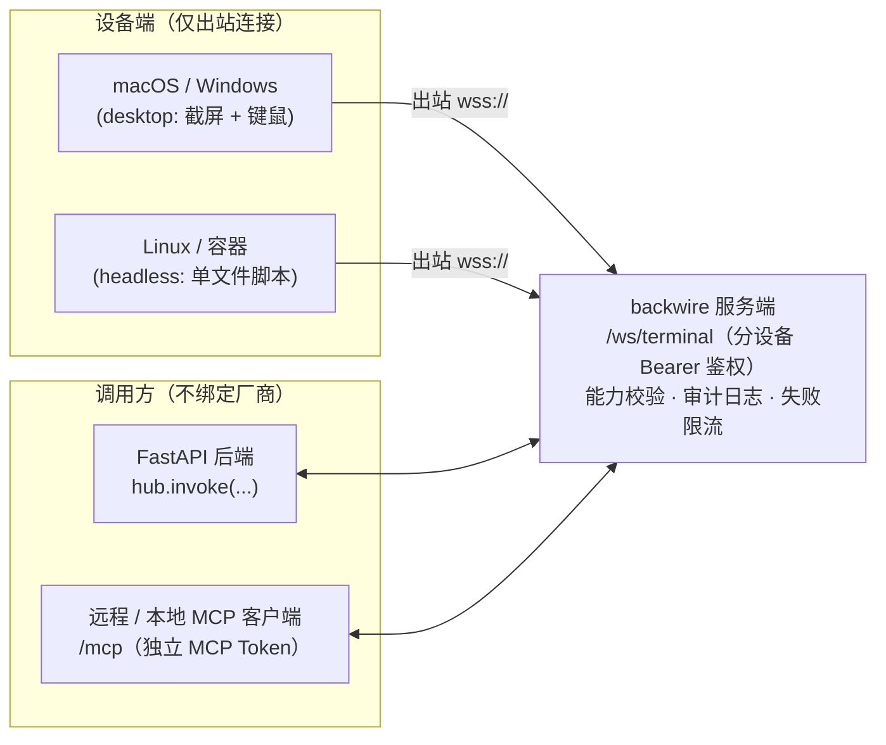

<div align="center">

# backwire

**反向 WebSocket 远程终端与桌面操作桥接工具。**

可直接嵌入 FastAPI 后端，或作为带鉴权的 Streamable HTTP / stdio MCP 服务运行。

[](https://github.com/chuli1122/backwire/actions/workflows/ci.yml)
[](LICENSE)
[](pyproject.toml)
[](#方式二独立服务--mcp)
[](#连接设备客户端)

[English](README.md) · **简体中文**

</div>

---

> [!CAUTION]
> 启用 `--allow-shell`、`--allow-write` 或 `--allow-input`，会把**当前系统账号对应的权限**交给连接的模型或调用方。
> - 客户端默认以只读模式启动（`read`，`--kind desktop` 下附加 `screen`）。**不要对不受信任的模型或用户启用 `--allow-shell`。**
> - 请使用专用低权限系统账号，并为每台设备分配独立的长随机 token。
> - 公网部署务必在可信 TLS 反向代理后使用 `wss://`，不要暴露裸 `ws://`。
> - `/mcp` 必须配置独立于设备 token 的 `BACKWIRE_MCP_TOKEN`，未配置时一律拒绝请求。

## 概览

`backwire` 让位于局域网、NAT 之后或容器内的设备（无需公网 IP、入站端口或 VPN/TUN 网卡）通过一条出站 WebSocket 连接到服务端。嵌入的 FastAPI 应用或 MCP 客户端可将明确授权的操作路由回对应设备。



- **两种接入方式：** 在已有 FastAPI 后端里挂载 `create_ws_router`（无需安装 `mcp`），或运行 `backwire-server`（Streamable HTTP `/mcp`）与 `backwire-mcp`（本地 stdio）。
- **独立设备脚本：** 将 `client/backwire_client.py` 复制到任意 Python 3.9+ 设备即可运行，headless 模式仅依赖 `websockets`。
- **权限边界与审计：** 每设备独立 token（禁用 `*` 通配符）、服务端与客户端双向能力校验、文件 API 的 `--workdir` 路径限制，以及脱敏 JSONL 审计日志。

> [!NOTE]
> 是否支持远程 Streamable HTTP MCP 取决于具体客户端的当前版本和账号能力，部署前请先核对。

## 安装

从源码安装：

```bash
git clone https://github.com/chuli1122/backwire.git
cd backwire
python3 -m venv .venv
. .venv/bin/activate

# 核心包 + WebSocket 服务端（Python 3.10+，不含 MCP 依赖）
pip install -e .

# 核心包 + 可选 Streamable HTTP / stdio MCP 传输层
pip install -e '.[mcp]'

# 可选桌面操控依赖
pip install -e '.[desktop]'
```

- 未安装 `.[mcp]`（或使用 `backwire-server --no-mcp`）时，不会挂载 `/mcp`，访问返回 `404`。
- 已在 MCP SDK `1.27.0` 和 `2.x`（`MCPServer`）验证通过；若其他版本的传输层 API 变动导致初始化失败，请查看启动日志并固定已验证版本。
- **设备客户端：** `client/backwire_client.py` 为独立脚本，支持 Python `3.9+`（headless 仅需 `websockets`；desktop 模式还需 `pyautogui`、`pillow`、`pyperclip` 及平台桌面依赖）。

## 快速上手

### 方式一：嵌入 FastAPI 后端（无需 MCP）

```python
from fastapi import FastAPI
from backwire import BackwireConfig, BackwireHub, create_ws_router

config = BackwireConfig.with_tokens({
    "laptop": "REPLACE_WITH_LONG_RANDOM_DEVICE_TOKEN",
})
hub = BackwireHub(config)

app = FastAPI()
app.include_router(create_ws_router(hub, config))

# 在业务代码里直接调用：
# devices = await hub.list_devices()
# result = await hub.invoke("read_file", {"path": "notes.txt"})
# result = await hub.invoke("run_bash", {"command": "uname -a"}, timeout=65)
```

带应用层 Bearer 鉴权和显式设备参数的完整示例见 [`examples/embed_fastapi.py`](examples/embed_fastapi.py)。业务路由调用 `hub.invoke` 时须自行做应用层鉴权，不可无认证暴露。

### 方式二：独立服务 + MCP

设备 token 与 MCP token 分开配置（支持明文或 `sha256:<64位十六进制>`）：

```bash
export BACKWIRE_TOKENS_JSON='{"laptop":"REPLACE_WITH_LONG_RANDOM_DEVICE_TOKEN"}'
export BACKWIRE_MCP_TOKEN='REPLACE_WITH_LONG_RANDOM_MCP_TOKEN'
backwire-server --host 127.0.0.1 --port 8000
```

| 端点 | 用途 |
|---|---|
| `GET /healthz` | 最小健康检查（仅返回 `{"ok": true}`） |
| `WSS /ws/terminal` | 设备反向 WebSocket 入口（`Authorization: Bearer <设备token>`、`X-Device-Name`） |
| `POST/GET /mcp` | 远程 Streamable HTTP MCP 规范地址（`Authorization: Bearer <MCP token>`） |

- **MCP 工具：** `list_devices`、`run_command`（映射核心 `run_bash`）、`read_file`、`write_file`、`screenshot`、`mouse_click`、`keyboard_type`、`hotkey`、`scroll`。
- **默认设备路由：** 未传 `device` 时，优先使用 `BACKWIRE_DEFAULT_DEVICE`，其次在 `BACKWIRE_PREFER_DESKTOP_DEFAULT=true` 时优先 `desktop` 设备，最后取首个在线设备。生产环境建议显式指定 `device`。
- **本地 stdio MCP：** `backwire-mcp --ws-host 127.0.0.1 --ws-port 8765` 同时运行 stdio MCP 和 WebSocket 监听（不提供 HTTP `/mcp` 或 `/healthz`）。将 `--ws-host` 绑到非本机地址会暴露明文 WebSocket。

### 连接设备客户端

先创建工作目录（`--workdir` 只做路径边界校验，不会自动创建目录）：

```bash
mkdir -p "$HOME/backwire-work"

python3 client/backwire_client.py \
  --url wss://your-host.example/ws/terminal \
  --token 'REPLACE_WITH_LONG_RANDOM_DEVICE_TOKEN' \
  --name laptop \
  --kind headless \
  --workdir "$HOME/backwire-work"
```

- **默认能力与传输：** 默认只读（`read`，`--kind desktop` 下附加 `screen`）。默认拒绝非本机明文 `ws://`，除非显式传入 `--allow-insecure-ws`（启动时会打印警告）。写文件、执行命令和键鼠输入分别需通过 `--allow-write`、`--allow-shell`、`--allow-input` 开启。
- **文件与截图限制：** `--workdir` 拦截 `read_file` 和 `write_file` 的路径穿越与符号链接逃逸；不传时文件 API 可访问当前系统账号有权限读取的任意路径。`read_file` 拒绝非常规文件，单次上限 200,000 字符 / 512 KiB，支持通过 `offset` 按字节偏移分页续读（返回 `offset`、`next_offset`、`truncated`、`size_bytes`）。`screenshot` 直接返回内存 PNG base64，不写入磁盘。
- **Shell 与重连：** `--workdir` **不是** shell 命令的操作系统沙箱。`run_bash` 在 Windows 使用系统 shell（`subprocess.run(..., shell=True)`），在 POSIX 优先使用 `/bin/bash` 并在缺失时回退默认 shell；单次超时硬封顶 300 秒、输出上限 200 KiB，超时或超限会终止进程组/进程树。断线后按 1–30 秒指数退避重连。

## 与 Tailscale + SSH 的对比

| | `backwire` | Tailscale + SSH |
|---|---|---|
| 连接方向 | 设备主动出站 WebSocket（不依赖入站端口或 TUN） | 操作方经私网连向设备 |
| 模型 / 工具集成 | 嵌入式 FastAPI Hub 与结构化 MCP 工具 | 需额外封装 SSH 或集成工具层 |
| 桌面截屏与键鼠 | 可选显式能力（`desktop` 模式） | SSH 本身不包含 |
| 安全边界 | 分设备 token、能力校验、`--workdir` 限制、审计日志 | 组网身份、SSH 密钥、OS 账号策略 |
| 适用场景 | 需要小工具面的受控应用或 Agent | 人工运维与通用安全终端 |

---

## 配置与部署参考

<details>
<summary><strong>Nginx 反向代理配置（WSS + Streamable HTTP MCP）</strong></summary>

同时匹配 `/mcp` 与 `/mcp/*`，透传 `Host` 并关闭响应缓冲：

```nginx
location /ws/terminal {
    proxy_pass http://127.0.0.1:8000;
    proxy_http_version 1.1;
    proxy_set_header Upgrade $http_upgrade;
    proxy_set_header Connection "upgrade";
    proxy_set_header Host $host;
    proxy_set_header X-Real-IP $remote_addr;
    proxy_set_header X-Forwarded-For $proxy_add_x_forwarded_for;
    proxy_set_header X-Forwarded-Proto $scheme;
    proxy_read_timeout 3600s;
    proxy_send_timeout 3600s;
}

location ~ ^/mcp(?:/|$) {
    proxy_pass http://127.0.0.1:8000;
    proxy_set_header Host $host;
    proxy_set_header X-Real-IP $remote_addr;
    proxy_set_header X-Forwarded-For $proxy_add_x_forwarded_for;
    proxy_set_header X-Forwarded-Proto $scheme;
    proxy_buffering off;
    proxy_cache off;
    proxy_read_timeout 3600s;
    proxy_send_timeout 3600s;
}
```

- 公网部署建议设置 `BACKWIRE_MCP_ALLOWED_HOSTS`（例如 `mcp.example.com,mcp.example.com:443`），开启与反代 `Host` 匹配的 DNS 重绑定保护；未设置时默认关闭以兼容反代。
- 设置 `BACKWIRE_TRUSTED_PROXIES` 为固定反代的 IP 或 CIDR（本机 Nginx 可设为 `127.0.0.1,::1`），认证失败限流才会使用 `X-Real-IP` 或 `X-Forwarded-For`。未设置时按 `client.host` 统计；反代后所有请求会共用代理地址计数。直连端不在白名单时忽略转发头。

</details>

<details>
<summary><strong>环境变量与默认值速查</strong></summary>

| 环境变量 | 默认值 / 说明 |
|---|---|
| `BACKWIRE_HOST` / `BACKWIRE_PORT` | `127.0.0.1` / `8000`（`--host` / `--port` 优先） |
| `BACKWIRE_TOKENS_JSON` / `BACKWIRE_TOKENS_FILE` | 分设备 token（JSON 优先；明文或 `sha256:<hex>`；拒绝 `*` 通配符） |
| `BACKWIRE_MCP_TOKEN` / `BACKWIRE_MCP_TOKENS_JSON` | 独立 MCP token（单值优先；`/mcp` 必填） |
| `BACKWIRE_MCP_ALLOWED_HOSTS` | 空（关闭 DNS 重绑定校验）；逗号分隔的 Host 白名单 |
| `BACKWIRE_TRUSTED_PROXIES` | 空（忽略转发头）；逗号分隔的反代 IP 或 CIDR，例如 `127.0.0.1,::1` |
| `BACKWIRE_ALLOW_QUERY_TOKEN` | `false`（公网保持关闭，避免泄露进日志） |
| `BACKWIRE_MAX_MESSAGE_BYTES` | `8388608`（8 MiB） |
| `BACKWIRE_COMMAND_TIMEOUT_SECONDS` | `65` 秒（硬上限 300 秒） |
| `BACKWIRE_MAX_AUTH_FAILURES_PER_MINUTE` | 每来源地址每分钟 `12` 次 |
| `BACKWIRE_AUDIT_LOG_PATH` | 空（关闭）；设置后写入脱敏 JSONL 日志（拒绝符号链接目标） |
| `BACKWIRE_DEFAULT_DEVICE` | 空；显式指定默认设备名 |
| `BACKWIRE_PREFER_DESKTOP_DEFAULT` | `true` |
| `BACKWIRE_URL`、`BACKWIRE_TOKEN`、`BACKWIRE_NAME`、`BACKWIRE_KIND`、`BACKWIRE_WORKDIR` | 设备客户端对应环境变量（`kind` 默认 `headless`） |

</details>

<details>
<summary><strong>设备客户端自启动模板（<code>deploy/</code>）</strong></summary>

`deploy/` 仅包含设备客户端自启动模板（不含服务端 unit 或 TLS 配置）：

- **systemd（Linux）：** 系统级模板；将 `deploy/systemd/backwire-client@.service` 放到 `/etc/systemd/system/`，创建用户的 `~/.config/backwire/client.env`（`chmod 600`）填入 `BACKWIRE_URL`、`BACKWIRE_TOKEN`、`BACKWIRE_NAME`、`BACKWIRE_WORKDIR`，复制 `client/backwire_client.py` 到 `~/bin/`，执行 `sudo systemctl daemon-reload && sudo systemctl enable --now backwire-client@<user>.service`。不要使用 `root` 实例，也不要对该模板使用 `systemctl --user`。
- **launchd（macOS）：** 将 `deploy/launchd/com.backwire.client.plist` 放到 `~/Library/LaunchAgents/`、`deploy/launchd/run_backwire_client.sh`（`chmod +x`）放到 `~/bin/`，凭据放进 `~/.config/backwire/client.env`（`chmod 600`，按键值对解析而非 `source` 执行），修改脚本路径后执行 `launchctl load`。
- **Windows：** 复制 `client/backwire_client.py`，在用户环境变量中配置 `BACKWIRE_URL`、`BACKWIRE_TOKEN`、`BACKWIRE_NAME`、`BACKWIRE_WORKDIR`（不在命令行传 token），使用 `deploy/windows/run_hidden.vbs` 后台启动。
- **容器启动配置模板：** 将 `client/backwire_client.py` 放到 `/opt/backwire/backwire_client.py`，注入 `BACKWIRE_*` 环境变量后以 `deploy/container/profile-autostart.sh` 启动。

</details>

## 许可证

[MIT](LICENSE)
